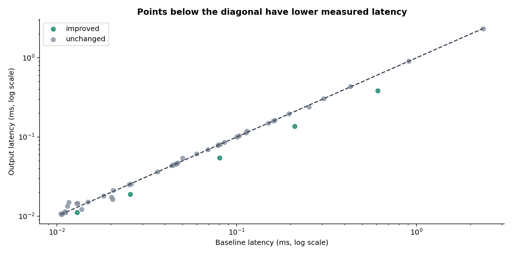
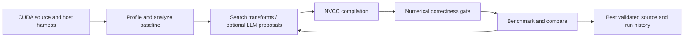

# CUDA Optimization Agent

A Python workbench for CUDA kernel optimization: compile candidates, validate numerical output, measure performance, and retain run history. Includes a Typer CLI, FastAPI API, built-in source transforms, and optional LLM candidate generation.

**Measured result:** five matrix-multiplication cases improved by **1.165–1.585x** on an RTX 2080 Ti. Across the full 60-case suite, **5 improved, 45 were unchanged, and 10 failed**. These are local benchmark results, not a claim of universal acceleration.

## Benchmark results

The [60-case report](workspace/suite60_20261028/REPORT.md) evaluates 12 kernel families at five sizes each on **NVIDIA RTX 2080 Ti (sm_75)**. The evidence is from the October 28, 2026 suite; development history begins in June 2026.

| Outcome | Cases | Share of all cases |
|---|---:|---:|
| Confirmed improvement | 5 | 8.3% |
| Unchanged source | 45 | 75.0% |
| Failed evaluation | 10 | 16.7% |
| Confirmed regression | 0 | 0.0% |

The five improvements selected the shared-memory tiling transform:

| Case | Baseline (ms) | Optimized (ms) | Speedup | Bootstrap 95% interval |
|---|---:|---:|---:|---:|
| matmul_96 | 0.012928 | 0.011099 | 1.165x | 1.032–1.380 |
| matmul_192 | 0.025583 | 0.018913 | 1.353x | 1.322–1.386 |
| matmul_320 | 0.080396 | 0.054346 | 1.479x | 1.477–1.481 |
| matmul_448 | 0.210329 | 0.136911 | 1.536x | 1.534–1.539 |
| matmul_640 | 0.608971 | 0.384301 | 1.585x | 1.538–1.619 |



**Methodology:** 18 candidate attempts per case; independent recompilation of baseline and output; 12 alternating timing samples per version, each using 5 warmups and 30 CUDA-event-timed launches. Numerical validation uses a NumPy float64 reference at `(size, seed=0)`, `(size+3, seed=1)`, and `(size-1, seed=7)` for both versions. The 50 successfully evaluated cases account for **300 CPU-reference checks**. Correctness was not established for all 60 cases.

A confirmed improvement requires changed source and a bootstrap 95% lower speedup bound above 1.01. Identical source remains classified as unchanged regardless of timing variation. No LLM credentials were supplied for this suite, and Nsight profiling was blocked by GPU-counter permissions. Related sizes within a kernel family are not independent algorithms. See the raw results for failure reasons and samples.

Evidence: [Word report](workspace/suite60_20261028/CUDA_60_Case_Optimization_Report.docx) · [CSV](workspace/suite60_20261028/results.csv) · [JSON](workspace/suite60_20261028/results.json) · [report validation](workspace/suite60_20261028/report_validation.json).

## How it works



- **Analysis:** PTX parsing, memory-access analysis, source features, bottleneck classification, and analytical roofline/occupancy models.
- **Search:** grid and random search across registered transforms, including shared-memory tiling, loop unrolling, register blocking, vectorized loads, warp shuffles, thread coarsening, and fusion. Applicability varies by source structure.
- **Evaluation:** NVCC compilation, executable output comparison, repeated timing, and statistical comparison before accepting a candidate.
- **Optional generation:** Claude, OpenAI, Gemini, Ollama, and OpenAI-compatible/vLLM providers propose candidates; compilation and validation remain separate acceptance gates.
- **Interfaces and persistence:** CLI, REST API, SQLAlchemy run history, metrics, and artifacts.

## Install

Requires **Python 3.11+**. GPU execution additionally needs an NVIDIA CUDA-capable GPU, compatible driver and CUDA Toolkit (`nvcc` on PATH). Profiling uses Nsight Compute (`ncu`) and appropriate GPU-counter access. Windows builds need MSVC C++ build tools. Mock-based tests can run without a GPU.

```powershell
git clone https://github.com/s-hir-o/cuda-opt-agent.git
cd cuda-opt-agent
python -m venv .venv
.venv\Scripts\Activate.ps1
python -m pip install -e ".[dev]"
cuda-opt --help
```

On Linux/macOS, activate with `source .venv/bin/activate`; real CUDA execution requires a supported CUDA host. Set `compiler.default_arch` in [config.yaml](config.yaml) for your GPU; its default is `sm_80`, while the published suite used `sm_75`.

## Run

```powershell
cuda-opt optimize workspace/suite60_20261028/matmul_192/input.cu --entry-point work --arch sm_75 --max-iter 18 --output workspace/matmul_optimized.cu
cuda-opt history
cuda-opt shell
```

Input must be a complete CUDA translation unit containing the selected `__global__` kernel and a host `main(...)`. Its executable must support `--output <path>` and write the expected raw numeric buffer (float32 by default). If no faster valid candidate is found, the CLI can return the baseline source. See [the CLI contract](docs/OPTIMIZE_CLI.md).

Configuration is loaded from YAML; use `--config path/to/config.yaml` to select one. Nested environment overrides use double underscores, for example `CUDA_OPT_COMPILER__DEFAULT_ARCH=sm_75`. Provider credentials belong in environment variables: `ANTHROPIC_API_KEY`, `OPENAI_API_KEY`, or `GEMINI_API_KEY`/`GOOGLE_API_KEY`. Local endpoints are configured in YAML. Missing provider credentials prevent that provider from proposing candidates; built-in transform search remains available.

Start the API:

```powershell
python -m uvicorn cuda_opt_agent.api.app:create_app --factory --host 127.0.0.1 --port 8000
```

Open `http://127.0.0.1:8000/docs` for the interactive API or `/health` for health status.

## Tests and reproducibility

```powershell
python -m pytest -q -m "not gpu"
python -m workspace.suite60_20261028.run_suite
```

Validation on November 4, 2026: **672 passed, 5 skipped** (non-GPU test run). The historical GPU measurements above were not rerun during publication.

The suite resumes existing per-case `result.json` files. For fresh measurements, use a separate checkout and remove saved case results there before running. The runner currently targets `sm_75`; adapt its configuration for different hardware. Clear hosted-provider credentials when reproducing the built-in-transform-only experiment. Published evidence includes sources, commands, results, report, and figures. Generated executables, raw output buffers, local databases, logs, and bundled report dependencies are omitted. Historical absolute paths in evidence describe the original machine. Report-building dependencies are separate from the package runtime.

## Repository layout

| Path | Purpose |
|---|---|
| `cuda_opt_agent/agents/` | Optimization coordinator and pipeline agents |
| `cuda_opt_agent/build/`, `profiling/`, `analysis/` | Compiler, profiler, and analysis integration |
| `cuda_opt_agent/transforms/`, `search/`, `cost_models/` | Candidate transforms, search, analytical models |
| `cuda_opt_agent/correctness/`, `benchmark/` | Output validation and timing comparison |
| `cuda_opt_agent/llm/` | Optional model-provider integrations |
| `cuda_opt_agent/api/`, `cli/`, `memory/` | User interfaces and persisted run data |
| `tests/` | Unit and integration tests |
| `workspace/suite60_20261028/` | Benchmark sources, raw results, figures, report, and runner |

## Scope and history

This is an experimental optimization workbench. Source transforms have limited pattern coverage; invalid candidates and unchanged outputs are expected. Bayesian/evolutionary search, learned/TVM cost models, and some compiler-analysis integrations are explicit stubs. GPU-counter availability and timing noise affect what can be measured.

Original development commits span **June 22–July 9, 2026**. The publishing history preserves original author/committer dates and messages, including the later audit commit. Historical snapshots were filtered to remove local secret-key files, environment files, generated caches, and development scratch material, so commit hashes changed. [The history map](docs/history-map.json) records that correspondence. Current implementation updates, benchmark evidence, and publication documentation use their actual publication dates rather than backdating October evidence into June/July.
